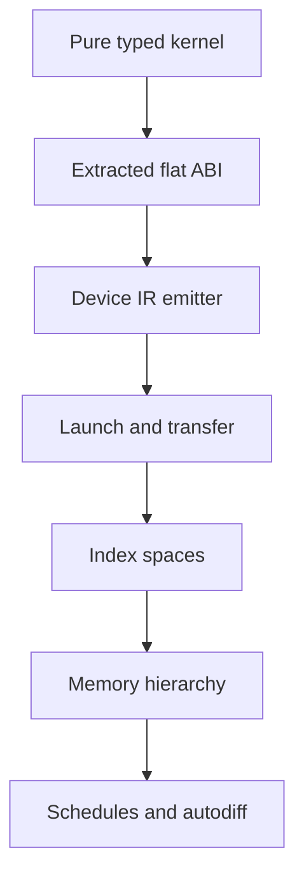

# Plan 0023 — GPU Computation: Surface Completion & Device Backends

**Subsystem:** `crates/osprey-types` + `crates/osprey-codegen` + `compiler/runtime` (+ CLI target drivers) **Status:** **Host surface shipped; device execution unimplemented.** Stages 1–2 (typed surface, purity checking, CPU host backend, eleven built-ins, differential corpus) are complete. Stage 3 (kernel extraction, `[GPU-KERNEL-EXTRACT]`) has **landed for admissible inline/let-bound lambda and scalar builtin kernels** — `crates/osprey-codegen/src/gpu_kernel.rs`, differentially gated against the retained inlined lowering — with two kernel shapes that still decline, listed under the stage 3 checklist. Stages 4–7 — *every* device backend — are unstarted. Until stage 4 lands, this feature runs entirely on the CPU and nothing in it may be described as GPU-accelerated. **Spec:** [0034-GPUComputation.md](../specs/0034-GPUComputation.md) **Sibling plan:** [0025 — GPU graphics backends](0025-gpu-graphics-backends.md) is **subordinate to this plan**: the graphics examples exist to demonstrate capability, and work there is admissible only where it advances `gpu*` reaching a device (the stage 6 convergence point). **Research last re-verified against primary sources:** 2026-10-12.

## Summary

The GPU surface is a language feature, not a library: `GpuBuffer<T>` in the type system, kernel purity proven by the effect checker (fail-closed), and a host execution backend whose fused loops over dense unboxed buffers define the reference semantics device backends must reproduce byte-for-byte. Kernel extraction makes each admissible kernel a real, first-order, capture-free function — the artifact a device emitter consumes. What remains is everything between an extracted kernel and a running device: an IR emitter, a launch and transfer path, effect-selected execution, portability backends, and the differentiation features (autodiff, schedules) the roadmap ends at.

## The ambition, stated as engineering

Osprey intends to be the language the next generation of AI and gaming infrastructure is built on — the premium language for GPU integration: one idiom from host to device, elegant on the page, safe by construction, with nothing bolted on. CUDA is a device code generator, an explicit memory hierarchy, a multi-dimensional index space, and a launch API — and Osprey today has **none of the four**. It has the thing that comes before them: a kernel that is provably pure, typed from its buffer, and compiled as a first-order function with no environment. That is real progress and roughly one quarter of the distance to a first device execution, not to parity. Every claim in this plan is held to that arithmetic.

## Read this first: `gpu*` does not touch a GPU

Nothing in the shipped `gpu*` surface runs on graphics hardware. `gpuMap` is a `for` loop on the CPU, `gpuDevice()` returns the string `"host"`, and no code path in the compiler or runtime talks to a driver. `[GPU-BACKEND-HOST]` is the only backend that exists; `[GPU-BACKEND-DEVICE]` is stage 4 and unstarted.

The names are a *dispatch surface* — the shape a kernel must have to be offloadable later. They are not a claim about where the work happens. Anything that reads otherwise (a make target, a demo header, a README line) is a documentation defect; fix it where you find it.

### What that costs, measured

Two measurements, both dated; neither is a current performance claim.

**July 2026, M-series Mac, release build, default memory backend** (historical — predates explicit `Arith` policies and kernel extraction):

| Workload | Result |
| --- | --- |
| Per checked arithmetic op inside a kernel | **~18 ns** (~60–70 cycles) |
| `examples/graphics` fragment scene, 2 × `gpuMap` + `gpuZipWith` + blit over 64 000 px | **76 ms/frame → 13 fps** |
| Same scene as a Metal fragment shader, 1920×1200 drawable | **103 fps** |

**2026-10-12, AMD Ryzen 9 3900X (24 threads), Linux 6.18 under WSL2, release build of this branch, default memory backend** — the extraction payoff the stage 3 checklist owed:

| `tests/core/gpu/stress.test.osp`, compiled once per lowering with `--compile -o`, same binary timed 10× | `OSPREY_GPU_KERNELS=extract` | `OSPREY_GPU_KERNELS=inline` |
| --- | --- | --- |
| Extracted `@__gpu_kernel_N` definitions in the module | 18 | 0 |
| User CPU seconds, pinned (`taskset -c 2`, `/usr/bin/time -f %U`), median of 10 | 0.295 | 0.295 |
| Wall-clock ms, 10 runs (machine not idle: a `make build` overlapped) | 547–717 | 561–672 |
| Program output | byte-identical to `inline` | byte-identical to `extract` |

**Conclusion: extraction buys no measurable host-backend speedup; the two lowerings are within noise.** `mlkernels.test.osp` runs in ~4 ms under either and is too small to measure. Extraction is kept anyway — its value is the device ABI, not host speed — and the stage 3 "measure" item is closed with this result. Re-run before quoting any newer number.

### The graphics bridge already exists — and is a different, subordinate plan

`examples/graphics/` is an Osprey → GPU bridge that deliberately **bypasses `gpu*`**, because `gpu*` cannot reach the GPU. The Metal path has been observed running on macOS (the 103 fps row above); the Direct3D 12 path is written but has never been compiled, linked or run on Windows (plan 0025 owns that status). Neither runs in CI: they need a display and are not in the differential corpus. The uniform-slot protocol both bridges implement is declared once, in `examples/graphics/ospgfx_abi.h`, and a kernel's leading uniform parameters are exactly a slot vector — that header is the seam stage 6 attaches to. Everything else about graphics is [plan 0025](0025-gpu-graphics-backends.md)'s, and under the current priority that plan does only what feeds stage 6.

## What works today

- `GpuBuffer<T>` with the scalar element restriction `[GPU-BUFFER-ELEM]` enforced at call sites (`builtin_constraints.rs`) and backstopped in codegen by **one predicate**, `gpu::is_scalar` (`crates/osprey-codegen/src/gpu.rs`), which element stores, kernel results, reduction accumulators, builtin-kernel slots and extracted-kernel uniforms all consult. The `Gpu#<lltype>` owner-tag scheme propagates element `LType`s through lets, pipes, parameters and returns; every tag is joined to its spelling at one point (`gpu::owner_of`).
- Eleven built-ins: `toGpu`, `fromGpu`, `gpuLength`, `gpuMap`, `gpuFold`, `gpuZipWith`, `gpuIota`, `gpuGet`, `gpuScan`, `gpuFilter`, `gpuDevice` — each with a docs entry (parity-tested) and spec ID. `toFloat` (`[BUILTIN-TOFLOAT]`) is the scalar conversion that makes float pipelines expressible. Codegen is split by role: `gpu/buffer.rs` holds the host↔buffer boundary (`toGpu` in its literal, fused and list lowerings; `fromGpu`), `gpu.rs` the combinators on a shared chassis (`map_into` for `gpuMap`/`gpuZipWith`, `reduction` for `gpuFold`/`gpuScan`, `kernel_loop` under all of them), `gpu_kernel.rs` extraction.
- Two list-free buffer constructions: buffer literals `[GPU-BUFFER-LITERAL]` and iterator fusion `[GPU-BUFFER-FUSE]`. Both emit zero `osprey_list_*` calls, pinned by `gpu_literals_make_one_buffer_with_constant_stores` and `gpu_iterator_pipelines_do_not_materialize_intermediate_collections`.
- Kernel purity `[GPU-KERNEL-PURE]` via the static effect discharge machinery (`effect_rows/gpu.rs::gpu_kernel_verdict`), fail-closed, with rejection fixtures in `examples/failscompilation/`. `Arith` is the one effect a kernel may still require on the host backend: it dispatches to the enclosing policy like any lambda's arithmetic does (spec `[GPU-KERNEL-EXTRACT]`).
- Dense-buffer C runtime (`compiler/runtime/gpu_runtime.c`) working under all three memory backends and wasm32; one bounds predicate (`addressable`) behind read, write and the `Result` gate; ARC reclaims buffers with zero leaks; 4 180 assertions in `gpu_runtime_tests.c`.
- Kernel extraction `[GPU-KERNEL-EXTRACT]` (`crates/osprey-codegen/src/gpu_kernel.rs`): an admissible kernel is lifted to a module-scope `@__gpu_kernel_N` with a flat scalar signature — captures become **leading uniform parameters**, ordered by identifier, no environment pointer, no closure cell — and the host loop calls it per element. Scalar builtins passed by name get a wrapper over their intrinsic lowering (`gpu_kernel/builtin.rs`). Per-suite extracted-definition floors are asserted for both flavors in `crates/osprey-cli/tests/cross_flavor_ir_equiv/gpu.rs::EXTRACTION_FLOORS` — eight of the nine suites; `flavor_parity` (two cases) carries no floor — and the exact zip/scan/filter ABIs in `zip_scan_and_filter_have_exact_scalar_abis`. These are structural floors, not performance measurements. Opaque computed callbacks and host-bound captures still decline — see the stage 3 checklist.
- Every kernel FORM `[GPU-KERNEL-FORM]` names compiles: named functions, inline lambdas, block-bodied lambdas, capturing closures, and recursive unannotated helpers, the last by monomorphisation (`crates/osprey-codegen/src/monofn.rs`) rather than by inlining.
- Scalar element types survive every host/device crossing: runtime lists carry an element-typed owner tag (`List#double`) exactly as buffers do, so `toGpu`/`fromGpu` round-trip floats and bools losslessly.
- Both lowerings are retained and differentially gated: `OSPREY_GPU_KERNELS` selects `extract` (default) or `inline`, any other value is a compile error, and `crates/run_test_corpus.sh` re-dispatches every `tests/core/gpu` program under the opposite lowering into `$RESULTDIR/altmode` and requires the whole observable outcome to AGREE — exit status, raw transcript bytes via `cmp`, and (under ARC) a present-and-zero leak sentinel. `test_cache_key` in `osprey-cli/src/main.rs` hashes the switch, so the two modes cannot share a cached binary.
- Differential corpus: nine suites × two flavors in `tests/core/gpu/`, **123 cases** (buffers 16, combinators 18, mlkernels 17, gamedev 21, stress 16, raster 13, scalar_contracts 7, kernel_frontier 13, flavor_parity 2 — `grep -c 'test('` on each Default twin; the ML twins carry the same counts under `grep -cE '^\s*test\b'`, since ML spells a case `test "name"`), covering round-trips, all ten data combinators, dot/matvec/relu/softmax/gradient descent, fixed-point particles/collision/palette work, fragment-shaped raster rendering, checked arithmetic at both sides of every i64 boundary, float accumulation ordering, and million-element workloads with closed-form expected values. Twins emit identical IR; goldens are byte-exact — raw `cmp`, not a trimmed compare — under default/GC/ARC and wasm32. The corpus carries **no redundant type annotation**: `osprey <file> --check` reports zero `redundant-annotation` warnings for all eighteen twins, and the annotations that remain (for example `maxI(a, b: int)`, `lessF(a, b: float)`, `oobMessage(buf: GpuBuffer<int>, i)`) are the ones inference cannot replace — a comparison between two unpinned parameters has no overload resolution the way `+` now does.
- **Floors are sourced, not copied.** `GOLDEN_MIN` and `GPU_MODE_MIN` live in `crates/run_test_corpus.sh` (on 2026-10-12: 217 native goldens, 151 wasm32, 18 kernel-mode pairs). Quote the script, never a remembered total.

## Defects the expanded corpus exposed — now fixed

All four are fixed and pinned by `tests/core/gpu/scalar_contracts` and `tests/core/gpu/flavor_parity`. They are kept here because each names a contract a device backend inherits.

1. **`fromGpu` on a float or bool buffer could not be read back** (`[GPU-BUFFER-TO-LIST]`) — FIXED. The root cause was language-wide, not GPU-specific: a runtime `List<T>` stores every element as a uniform `i64` word and nothing recorded what the word meant, so `listGet([1.5], 0)` handed back IEEE-754 bits typed as an `int` and `forEachList` printed them. Runtime list handles now carry the same element-typed owner tag buffers do (`List#double`, `crates/osprey-codegen/src/collections.rs`), `types.rs::owner_name` gives `List<T>` that tag so it survives parameters, returns and fields, and `fromGpu` copies the buffer's element type onto the list it builds.
2. **`toGpu(list-value)` lost the element tag** (`[GPU-BUFFER-FROM-LIST]`) — FIXED by the same tag: `to_gpu` reads the element type from either list representation. A worse defect sat underneath it — a list *literal* returned from a function, stored in a record field or passed to a non-inlined callee kept its flat `{ length, data }` layout while the receiver, which sees only `List<T>`, handed that header to the list runtime: `fn xs() = [1, 2, 3]` then `toGpu(xs())` gave garbage, and the float twin **segfaulted**. Every escape now normalises to the runtime layout (`crates/osprey-codegen/src/listlit.rs::escaping`).
3. **`-9223372036854775808` was accepted in Default and rejected in ML** — FIXED. The ML lexer emits the `i64::MIN` magnitude as its own token, which the parser folds under a unary minus and rejects anywhere else — the rule the Default frontend already had. The related juxtaposition defect is fixed too: a `-` spaced from what precedes it and glued to the digits that follow is a negative literal ARGUMENT (`gpuIota -3`), not subtraction, so the twins parse alike. Default's own precedence was the mirror defect — `-7 |> gpuIota()` parsed as `-(7 |> gpuIota())`, because the grammar bound `|>` tighter than unary; unary now binds tighter, matching ML.
4. **Kernel element typing was order-sensitive within one expression** (`[GPU-KERNEL-ELEM-TYPING]`) — FIXED. Call arguments are now checked against the callee's signature: non-lambda arguments are inferred and linked to their slots first, then each lambda is inferred with the parameter type those links pinned (`crates/osprey-types/src/expr.rs::positional_arg_types`). Both `fn(x, y) => t * x * y` and `fn(x, y) => x * y * t` compile, and `gpuFold(0.0, fn(a, v) => a + v)` no longer needs annotations. The NAMED context-free case (`fn plus(a, b) = a + b`) is fixed too, by the other half of plan 0022's F10: the definition records a PENDING overload instead of defaulting where no call site is in sight, and the choice is settled once, after all unification, from the operands' final types.

Both delegated cases below are closed, and `tests/core/gpu/kernel_frontier` and `tests/core/gpu/scalar_contracts` are green in both flavors under default/GC/ARC and wasm32:

- **A named context-free numeric function can serve a float slot** (F10, [the shipped scalar contract](../specs/0037-ArithmeticEffects.md#floating-point-results--float-ieee-results)). No numeric class was needed: the overload is left open and settled after unification, at the cost that one definition gets one overload (using a helper at both `int` and `float` is a type error, not a reinterpretation).
- **An empty list literal reaches codegen with its element type.** `Expr::List` carries a position, inference publishes each literal's resolved `List<T>` there (`ProgramTypes::lists`), and `toGpu([])` / `[]` tag their handle from it. The other half of that case was a language-wide inference hole: the `?:` desugaring binds its payload through an unspellable field name, and `bind_result_fields` typed anything it did not recognise as a FRESH variable, so `listGet([1, 2, 3], 0) ?: 9.5` type-checked on an `int` list and only failed in codegen. A `Success`/`Error` pattern over an unresolved discriminant now pins it to a `Result` with an open payload instead of auto-wrapping it.

## Spec statements the corpus falsified — now corrected

The corrections below have been applied to `docs/specs/0034-GPUComputation.md`; they are kept as the record of why.

- **`[GPU-KERNEL-FORM]`'s first implementation gap was stale.** A block-bodied lambda with an internal `let` works as a kernel and always did. The bullet is deleted; both flavors now exercise the case.
- **`[GPU-KERNEL-FORM]`'s second gap is now implemented, not scoped.** A recursive unannotated helper is monomorphised per instantiation (`crates/osprey-codegen/src/monofn.rs`), so the annotations are optional. Only an unresolvable *return* type still fails closed.
- **`[GPU-SCAN]` never defined its `initial` parameter** and **`[GPU-IOTA]` never defined `n <= 0`.** Both are now normative in the spec: `result[0] = combine(initial, src[0])`, and a non-positive `n` yields an empty buffer.
- **`[GPU-KERNEL-PURE]` described the kernel row as empty.** It is empty of every effect except `Arith`, which the host backend discharges through the enclosing policy; the section now says so and points at the extraction section's boundary rule.

## Design decisions carried from the research foundation

The bibliography lives in the spec's References section (`[GPU-RESEARCH]`). The *decisions* that research produced are recorded here because they shape the remaining stages. Every external fact below was re-verified against its primary source on **2026-10-12**; re-verify before any public claim.

- **Device sublanguage, not device ADTs.** Every production functional GPU language (Futhark — [Henriksen et al., PLDI 2017](https://doi.org/10.1145/3062341.3062354); Accelerate — [McDonell et al., ICFP 2013](https://doi.org/10.1145/2500365.2500595)) restricts device data to a regular, first-order scalar sublanguage; ADTs, closures and pattern matching stay in host code and at kernel boundaries. The imperative counterpart reaches the same place from the other side: Descend ([Köpcke, Steuwer, Gorlatch, PLDI 2024](https://doi.org/10.1145/3656411)) gets CUDA-parity performance with Rust-style ownership and lifetimes tracked in the type system, and Prism/Bundl ([PLDI 2026, Distinguished Paper](https://doi.org/10.1145/3808290)) puts the *granularity of thread control* into the type as "typed perspectives" so collective operations compose modularly. Osprey's ADT advantage is a host/boundary feature by design, and `[GPU-BUFFER-ELEM]` is that decision made normative.
- **Backend substrate — decision checkpoint at stage 4 kickoff.** Osprey emits textual LLVM IR and hands it to clang (no LLVM linkage), and the wasm32 target already works as a sibling link driver (`crates/osprey-cli/src/wasm.rs`). The incremental device path follows that shape: NVPTX via clang ([NVPTX back-end user guide](https://llvm.org/docs/NVPTXUsage.html); [Compiling CUDA with clang](https://llvm.org/docs/CompileCudaWithLLVM.html)) plus a CUDA-driver launch shim. The portability route is now equally in-tree: the **LLVM SPIR-V backend was promoted from experimental to an official target** (added to `LLVM_ALL_TARGETS`, LLVM 20), so one textual-IR emitter can feed both PTX and SPIR-V without a second toolchain. The strategic alternative is an MLIR pipeline (`gpu` → `nvgpu` → `nvvm`) — how Mojo gets tensor-core/TMA access without hand-written PTX. The tile layer is no longer speculation: **NVIDIA open-sourced CUDA Tile IR on 2025-12-04 (Apache-2.0, with CUDA 13.1)** — an MLIR Tile dialect, Python bindings, bytecode and a conformance suite ([NVIDIA/cuda-tile](https://github.com/NVIDIA/cuda-tile)) — and Triton's in-tree **Gluon** dialect exposes Blackwell's `tcgen05`/TMA primitives directly. The directly comparable study for a functional array language choosing between OpenCL, CUDA and HIP as compilation targets is Henriksen's ([FProPer 2024](https://futhark-lang.org/publications.html)); read it before the checkpoint. Choose at stage 4 kickoff; do not commit in the spec.
- **Effect classification is the stage-5 design.** Dex distinguishes parallelism-destroying `State` from the parallelism-preserving, monoidal `Accum` effect ([Paszke et al., ICFP 2021](https://arxiv.org/abs/2104.05372)); Xie, Johnson, Maclaurin and Paszke ([ICFP 2024](https://doi.org/10.1145/3674651)) give the formal account of which handler shapes commute with parallel evaluation — the theory closest to Osprey's handlers. The `Gpu` selection effect (stage 5) and any future accumulation effect must be designed against that work, not ad hoc.
- **Associativity does not authorize different results.** `[GPU-FOLD]` and `[GPU-SCAN]` require exact host-order results even for non-associative combines. An associativity claim alone is insufficient for floating-point reassociation; each device lowering must preserve the golden output.
- **Performance thresholds are gates, not aspirations.** Stage 4 does not promote its build flag until within 2× of Futhark/CUDA on stencil and reduction micro-benchmarks. The measured baseline for an MLIR-based challenger is Godoy et al. ([SC Workshops 2025, WACCPD best paper](https://arxiv.org/abs/2509.21039)): Mojo is "competitive with CUDA and HIP for memory-bound kernels", with "gaps on AMD GPUs for atomic operations and for fast-math compute-bound kernels on both AMD and NVIDIA GPUs" (H100 and MI300A; seven-point stencil, BabelStream, miniBUDE, Hartree-Fock). The abstract gives no percentage; an earlier "~87%" quoted here was not in the source and is withdrawn.
- **Algorithm/schedule separation is the stage-7 shape.** The functional combinator program is the algorithm; scheduling (tiling, fusion, memory placement) becomes an optional, typed, separate layer per Halide, TVM ([Chen et al., OSDI 2018](https://www.usenix.org/conference/osdi18/presentation/chen)) and Exo — never annotations smeared through kernel code. The tile-level authorities for what a schedule must be able to express on tensor-core hardware are CUTLASS/CuTe's layout algebra (now with a categorical foundation, [arXiv 2601.05972](https://arxiv.org/abs/2601.05972)) and ThunderKittens ([ICLR 2025](https://arxiv.org/abs/2410.20399)): 16×16 register tiles, managed shared-memory layouts, explicit asynchronous workers.
- **Autodiff is compiler-level, not library-level.** Enzyme ([Moses & Churavy, NeurIPS 2020](https://proceedings.neurips.cc/paper/2020/hash/9332c513ef44b682e9347822c2e457ac-Abstract.html); GPU kernels at [SC 2021](https://c.wsmoses.com/papers/EnzymeGPU.pdf)) differentiates LLVM IR after optimisation and was the first reverse-mode AD of GPU kernels — the natural fit for a compiler that already emits LLVM IR. The functional foundations stay Elliott (ICFP 2018), Dex, Slang.D, and the POPL 2026 account of JAX/Dex autodiff as a linear-logic calculus ([DOI 10.1145/3776654](https://doi.org/10.1145/3776654)).
- **Competitive snapshot (verified 2026-10-12):** **Mojo 1.0 shipped on 2026-08-11** and its compiler was released under Apache-2.0 with LLVM exceptions on 2026-08-18, after Qualcomm's acquisition of Modular; external compiler contributions are not yet accepted (targeted end of 2026). NVIDIA announced **CUDA Rust** (two tracks: `cuda-oxide`, early alpha, and `cutile-rs`) in September 2026 alongside the community Rust CUDA reboot. HVM2/Bend compiles higher-order functional programs to C and CUDA through interaction combinators — the other functional-on-GPU route, with none of Osprey's static guarantees. Typed GPU programming has active venue appetite (Prism/Bundl at PLDI 2026; Kuiper at ARRAY 2025 — dependent types and concurrent separation logic extracting to CUDA; the POPL 2026 AD paper) — publishing the device sublanguage's type-and-effect rules is a credibility play worth its own milestone.

## Where the design already commits to the right shape — and where it must change

Where the current design already commits to the right shape:

- **Purity is proven, not promised.** `[GPU-KERNEL-PURE]` is discharged by the effect checker and fails closed. Every offload decision downstream rests on it, and no competitor with a library-shaped GPU surface can make it.
- **The element restriction is the device sublanguage.** `[GPU-BUFFER-ELEM]` is the Futhark/Accelerate discipline made normative before any device code exists, so no accepted program will have to be un-accepted later.
- **The buffer layout is already the transfer layout.** Dense, unboxed, contiguous — a device copy is a `memcpy`, not a marshalling pass.
- **The extracted ABI is the emitter's input.** Uniforms then element slots, scalar return, no environment pointer: a PTX/AIR/SPIR-V emitter walks that signature directly.
- **The host backend is the oracle.** Every backend is held byte-for-byte to it, and the `extract`/`inline` differential proves the harness can actually hold two code generators to one golden.

Where it will have to change — name these before promising anything:

- **One dimension.** Every combinator is rank-1 over a flat buffer. Real GPU work is `(x, y, z)` blocks and grids; a matrix today is a flat buffer plus an index kernel (`mlkernels`'s `matVec` literally does this). Multi-dimensional index spaces are a **surface change**, not a backend change, and the longer the corpus encodes flat indexing the more expensive it gets.
- **Transfer is invisible.** `toGpu`/`fromGpu` are a copy on the host today. Once a device exists they become the host↔device boundary, and a program that calls them in a loop is a program that is memory-bound by accident. Making the cost visible — in the type, in an effect, or in a diagnostic — is a design decision that has not been made.
- **No memory hierarchy.** Shared/local memory, tiling and coalescing are what separates a working kernel from a fast one. Stage 7's schedule layer is the intended home; nothing about the current surface expresses it.
- **No fusion between combinators.** Only `toGpu` fuses its iterator source; every other combinator allocates its result and runs its own loop. A transformer layer written today is a dozen buffers per token.
- **Reductions are semantically host-ordered.** `[GPU-FOLD]` and `[GPU-SCAN]` require the host's left-to-right result, pinned by `horner`, `subI`, and the float-ordering case. A device backend may reassociate only when it preserves the exact result; otherwise it must preserve the original order or use a sequential fallback. Keep the existing goldens and assertions.
- **Kernels that decline extraction have no device story.** Opaque computed closure cells and host-bound bodies lack a device-ready ABI. A device backend must reject the remaining unsupported shapes with a diagnostic naming the kernel, never silently offload.

## Reference application — GPT-2 from `llm.c`

The yardstick for every one of the gaps above is a real model, and the right one is Karpathy's [`llm.c`](https://github.com/karpathy/llm.c): GPT-2 pretraining in plain C and CUDA, with a ~1 000-line fp32 CPU reference (`train_gpt2.c`), the CUDA mainline (`train_gpt2.cu`), and a `dev/cuda` ladder of kernels from naive to tuned for every operation a transformer needs (matmul, layernorm, GELU, softmax, attention, residual, Adam). It is the standard "basic LLM that leverages GPUs" and it comes with its own reference outputs. The existing `mlkernels` suite (dot, matvec, relu, softmax, gradient descent) is the seed of this port, not a substitute for it.

**Status: not started.** Two halves, each a gate:

- **Half A — host parity, doable now.** Port the GPT-2 forward pass (and then the backward pass) to `gpu*` as an Osprey project, run it on the host backend against the same checkpoint and token batch `train_gpt2.c` consumes, and compare logits and loss against `train_gpt2.c`'s output at a stated, recorded tolerance (float accumulation order differs; "byte-identical" is not the bar here, a documented tolerance is). Record wall-clock against `train_gpt2.c` on the same CPU with the same environment metadata the table above carries. Where it lives: as a project under `examples/projects/` or `benchmarks/` — it will not fit `tests/`' 500-LOC file cap as one file, and it must not be split into unreadable fragments to force it there. Half A is the forcing function for the surface changes listed above: it will hit rank-1 indexing, host-ordered reductions, combinator-to-combinator fusion and invisible transfer on its first layer, and each of those then has a concrete program behind it rather than a paragraph.
- **Half B — device parity, the stage 4 gate.** The same Osprey program, unchanged, against `train_gpt2.cu`'s CUDA path on the same GPU. The 2× threshold that gates the stage 4 build flag is measured here, not only on micro-benchmarks.

## Remaining stages

4. **First device target — NVPTX.** Kernel IR compiled to PTX, a CUDA-driver launch path in the runtime behind a build flag, buffer transfer using the existing dense layout (which was chosen as the staging layout for exactly this moment). Gated on the 2× benchmark threshold and the `llm.c` half B gate.
5. **Effect-selected execution.** A `Gpu` effect whose handler chooses the execution strategy per lexical region; `gpuDevice()` reports the handler's choice; a test handler pins `"host"` so CI is deterministic with no GPU attached. This is the construct competitors bolt on as library calls — the headline language feature.
6. **Portability targets.** Metal (macOS CI can actually execute it; MSL is at specification 4.1 as of 2026-06-04) and WebGPU/WGSL beside the existing wasm target (WebGPU is a W3C Candidate Recommendation with drafts through 2026; Futhark has shipped and iterated a WebGPU backend, 2024–2025, which is the closest prior art for a functional array language on WGSL). Plan 0025's convergence point is here.
7. **Autodiff and schedules.** Differentiable kernels (Enzyme-style compiler AD over the emitted IR; Elliott's categorical core; Dex's parallelism-preserving accumulation; Slang.D's differentiable type discipline) and the optional schedule layer.

Stages ratchet: each keeps `make ci` green and the differential harness byte-exact, and later stages must not change the meaning of programs accepted by earlier stages (`[GPU-ROADMAP]`).

## Start here — the next session's work order

Only open work is listed; the stage 3 gate items the branch review raised are closed and recorded in the checklist.

1. **Reference application half A** (`llm.c` host port). It is the only item on this page that generates concrete evidence for the four surface gaps at once. Start with the forward pass of one layer and the tolerance comparison against `train_gpt2.c`; do not widen the surface speculatively before the program asks for it.
2. **Multi-dimensional index spaces** — design the surface change (rank-2 at least) before any device emitter exists, driven by the matmul and attention kernels half A needs. Every backend written against rank-1 buffers has to be revisited otherwise.
3. **Stage 4 substrate decision checkpoint**, informed by the three facts that changed since July: the LLVM SPIR-V backend is official, CUDA Tile IR is open source, and Henriksen's OpenCL/CUDA/HIP comparison exists. Record the decision and its benchmark evidence here.
4. **Stage 6 convergence with plan 0025** only when stage 4's emitter exists to converge with; graphics work before that is not admissible under the current priority.

Landmines previous sessions hit:

- Directly recursive generic helpers are emitted by `monofn.rs`, including buffer parameters, rather than recursively inlined. An unresolved return type still fails closed; mutual generic recursion remains subject to the re-entry guard. Do not reintroduce parameter annotations where the call site supplies the type.
- Twins must emit identical IR (`cargo test -p osprey-cli --test cross_flavor_ir_equiv`), so a construct only one flavor's parser accepts cannot enter the corpus.
- Goldens are byte-exact under default/GC/ARC **and** wasm32. Wasm goldens run under `make wasm`, not `make ci` — run both. `make wasm` also *builds* `libosprey_runtime_wasm.a`; without it every wasm golden fails at once. The tell is the harness's `TEST_CORPUS_SKIPPED=… TARGET=wasm32` line: it must equal the non-comment entry count of `tests/WASM_UNPORTABLE.txt` (the manifest is the source; do not copy the number here), and 0 means the wasm runtime archive did not build.
- `GOLDEN_MIN` counts *programs*, not test cases — adding a `test(...)` to an existing suite does not move it. Never lower it. `GPU_MODE_MIN` counts the `tests/core/gpu` programs re-run under the opposite kernel lowering; a tenth suite raises it by two. Both live in `crates/run_test_corpus.sh`.
- **A new kernel lowering must be cache-keyed.** `test_cache_key` hashes `OSPREY_GPU_KERNELS`; without that the harness compares one cached binary to itself and the differential silently passes forever. Falsify any new mode gate by breaking it on purpose once and watching it fail.
- The deslop duplication ceiling is defined in `.deslop.toml`. A new combinator must sit on the existing chassis — `kernel_of` for its kernel, `map_into` if it produces a buffer per element, `reduction` if it carries an accumulator, `kernel_loop` underneath — and any new lifted-call helper must reuse `closure.rs` rather than restating it. The element rule is `gpu::is_scalar`; do not restate its three-way match anywhere in GPU code. (`llty::scalar_spelling`'s four-way match, which also admits `Str`, is the owner-tag spelling table, not the element rule.)
- `gpu.rs` and `gpu_kernel.rs` are each within a hundred lines of the 500-LOC cap. The next addition to either goes in a new module beside `gpu/buffer.rs`, not at the bottom of the file.
- Float `/` returns `float`; a nonliteral divisor requires an enclosing runtime `Arith.divideByZero` policy on the host backend ([spec 0037](../specs/0037-ArithmeticEffects.md)). ML twins: no braces in constructor patterns (`Success value`), lambdas are `\x => …`, parenthesize match-arm and pipe continuations, and **parenthesize a negative literal argument** (`gpuIota (-4)`) or juxtaposition reads it as subtraction.
- A builtin passed by name as a callback needs a value form in `expr.rs::call_builtin_with_values`, or it emits `call @name` to a symbol that is never defined and fails at *link* time with no source location.
- A line opening with `(` starts a NEW statement ([LEX-STATEMENT-BREAK](../specs/0002-LexicalStructure.md#the-rule-lex-statement-break)). A callee and its argument list must still share one line.
- Lifted host kernels and materialized source lambdas emit their own `DISubprogram`, parameters and captured values; see [plan 0012](0012-osprey-debugger.md).
- Annotations in the corpus are defects unless the compiler keeps them: run `osprey <file> --check` and strip every `redundant-annotation` it names, in both twins, then prove the golden unchanged with `cmp`.

## TODO checklist

### Stage 1 — typed surface + host backend

- [x] `GpuBuffer<T>` type, `[GPU-BUFFER-ELEM]` call-site enforcement, `Gpu#` owner-tag element recovery.
- [x] `toGpu`/`fromGpu`/`gpuLength`/`gpuMap`/`gpuFold` + docs entries.
- [x] `[GPU-KERNEL-PURE]` fail-closed purity proof reusing static effect discharge; fixtures `gpu_kernel_impure.ospo`, `gpu_kernel_unprovable.ospo`, `gpu_buffer_element_not_scalar.ospo`.
- [x] Dense-buffer C runtime under default/GC/ARC + wasm32, zero ARC leaks.
- [x] `tests/core/gpu/buffers` twins + goldens; IR-equivalent flavors.

### Stage 2 — surface completion

- [x] `gpuZipWith` (`[GPU-ZIPWITH]`), `gpuIota` (`[GPU-IOTA]`), `gpuGet` (`[GPU-GET]`, `Result`-typed OOB), `gpuScan` (`[GPU-SCAN]`), `gpuFilter` (`[GPU-FILTER]` via `osprey_gpu_take` compaction).
- [x] `gpuDevice` (`[GPU-DEVICE]`) host introspection.
- [x] Corpus expansion to nine suites × two flavors, 123 cases, every source file under the 500-LOC cap, twins carrying identical case counts and sharing one golden.
- [x] Buffer literals `[GPU-BUFFER-LITERAL]` (`gpu/buffer.rs::buffer_literal`): one `osprey_gpu_alloc` plus constant-index stores, no `osprey_list_*`, no `malloc`, no loop.
- [x] `Iterator` → `GpuBuffer` fusion `[GPU-BUFFER-FUSE]` (`expr.rs::fuse_gpu_source` retargets the scheme's container; `gpu/buffer.rs::fuse_iterator` lowers it). A `filter` stage publishes the kept prefix via `osprey_gpu_take`; an inverted range yields an empty buffer.
- [x] Float pipeline seed — `toFloat` landed (plan 0004, `[BUILTIN-TOFLOAT]`); a builtin passed *by name* as a callback lowers to its value form at the callback site (`expr.rs::call_builtin_with_values`).
- [x] Block-bodied lambda kernels in both flavors; `every_extracting_combinator_preserves_its_source_arguments` (an IR test in `cross_flavor_ir_equiv/gpu.rs`) checks all five extracting combinators' debug metadata, and the editor fixture `extracted GPU kernel breakpoints expose uniforms and locals` (`vscode-extension/test/suite/debug-fixtures.ts`) executes a block-bodied kernel under LLDB-DAP in both flavors.
- [x] Directly recursive generic helpers specialize from their call sites through `monofn.rs`; `kernel_frontier::recursiveHelperCase` asserts the matrix results in both flavors.
- [x] Kernel element typing (plan 0022 F10): the overload is left open at the definition and settled after unification — no numeric class, no GPU-surface change.
- [x] The corpus carries no compiler-flagged redundant annotation in either flavor; goldens byte-identical before and after the strip.

### Stage 3 — kernel extraction

The mechanism is `crates/osprey-codegen/src/gpu_kernel.rs` (+ `gpu_kernel/builtin.rs` for scalar builtins); `iter.rs` gained one `Callback::Extracted` variant and one `invoke` arm, and `expr.rs` hoisted the lambda return adaptation into `fit_lambda_return` so the inline and extracted paths cannot drift.

- [x] Spec ID `[GPU-KERNEL-EXTRACT]` in 0034 defining the extracted ABI — uniforms (sorted by identifier) then element slots, scalar return, no environment pointer, the decline cases, determinism, and the differential guarantee.
- [x] Harness mode diffing extracted-kernel output against the inlined host-loop output for the whole `tests/core/gpu/` corpus, under every memory backend and on wasm32; floor `GPU_MODE_MIN` in `crates/run_test_corpus.sh`. Falsified once with a deliberately invalid mode (every pair reported `GPU-KERNEL-MODE-MISMATCH`), then reverted.
- [x] Closure captures lowered to explicit kernel parameters, sorted by identifier; a captured `GpuBuffer` handle is admissible as a uniform.
- [x] Generic kernels are monomorphised rather than inlined.
- [x] Host GPU callback requirements propagate through the ordinary effect solver: all five combinators reject unhandled arithmetic in both flavors, accept an explicit policy, and reject recovery-arm arithmetic without an outer policy.
- [x] Scalar builtins passed by name extract through the shared intrinsic lowering; IR tests require real scalar definitions and calls without closure environments in both flavors.
- [x] Known let-bound lambdas lift from their definition-time capture snapshot, including materialized local cells and nonempty lexical environments.
- [x] Extraction structure gated: per-suite minima (`EXTRACTION_FLOORS`) and exact zip/scan/filter ABIs in both flavors; disabling extraction fails the gate even when runtime output agrees.
- [x] Literal and fused-pipeline allocation/loop structure asserted; no intermediate collections.
- [x] Every combinator has purity coverage: transitive dynamic-effect rejection, pure controls and fail-closed unknown callbacks in both flavors; the ML rejection fixture pairs the Default one.
- [x] Return reconstruction shared: `gpu_kernel::extracted_call` and `closure::cell_call` both use `closure::returned`.
- [x] Debugger scopes preserved for extracted host kernels; real LLDB-DAP editor tests assert `x = 40`, uniform `n = 2` and local `sum = 42`.
- [x] **Host-backend payoff measured** (2026-10-12, table above): no measurable speedup; extraction kept for the device ABI.
- [x] One scalar predicate (`gpu::is_scalar`), one owner-tag join (`gpu::owner_of`), one map/zip chassis (`map_into`), one fold/scan preamble (`reduction`), one C bounds predicate (`addressable`); `gpu.rs` split into `gpu.rs` + `gpu/buffer.rs` under the 500-LOC cap.
- [ ] **Extract *every* combinator kernel.** Not done — two shapes still take the inlined lowering, each for a stated reason, each safe (the pre-extraction lowering produces the same values):
      - **Opaque computed closure cells** (`Callback::Value`, or a function-typed local without a known lambda body). A record field or unknown factory result still carries a runtime environment. Device offloading must recover a concrete body and flat uniforms or reject this shape explicitly; it cannot pass a host environment pointer.
      - **Bodies reaching host-only state** — a free name in `cell_slots`, `lambdas`, `fn_ptr_locals` or `call_aliases`, a non-scalar/non-buffer capture, or a `Result`/Fiber parameter slot. `admissible` declines rather than emit `call @f` to an undefined symbol.
      A **named function** kernel is deliberately not lifted and is *not* a gap: the host loop already calls its emitted symbol, which is the extracted form.

### Reference application — `llm.c`

- [ ] Half A: GPT-2 forward pass as an Osprey `gpu*` project; logits/loss compared with `train_gpt2.c` at a recorded tolerance on the same checkpoint and tokens; wall-clock recorded with environment metadata.
- [ ] Half A: backward pass and one optimiser step to the same bar.
- [ ] Record, per layer, which of the four surface gaps (rank-1 indexing, host-ordered reductions, no fusion, invisible transfer) it hit and what the program had to do about it; feed each into the stage below that owns it.
- [ ] Half B (stage 4 gate): the unchanged program against `train_gpt2.cu` on the same GPU, within 2×.

### Stage 4 — first device target (NVPTX)

- [ ] Backend-substrate decision checkpoint: clang/NVPTX sibling driver (wasm-shaped) vs MLIR `gpu`→`nvgpu`→`nvvm`, weighing the official LLVM SPIR-V backend and CUDA Tile IR; record the decision and its benchmark evidence here.
- [ ] PTX emission for extracted kernels behind a build flag.
- [ ] CUDA driver launch + transfer shim in `compiler/runtime/` using the existing dense staging layout; no API surface change.
- [ ] CI story with no GPU: device path compiles everywhere, executes where hardware exists, host diff remains the source of truth.
- [ ] **Decline-to-offload diagnostic.** Every kernel shape stage 3 declines to extract must be rejected by name at the launch site, never silently run on the host inside a region the program believes is on the device.
- [ ] **Non-associative reduction decision.** Either restrict device reduction to associative combines (checked how?) or run a sequential device fallback. Decide before PTX emission, not after the goldens break.
- [ ] Benchmark gate: within 2× of Futhark/CUDA on stencil + reduction micro-benchmarks AND `llm.c` half B before the flag is promoted; record numbers in `benchmarks/`.

### Stage 5 — effect-selected execution

- [ ] `Gpu` effect + handler-selected execution strategy per region; design reviewed against Xie et al. (ICFP 2024) handler-commutation results.
- [ ] `gpuDevice()` reports the innermost handler's selection; host default with no handler.
- [ ] Purity interaction specified: kernels stay pure; *scheduling* is the effectful part ([GPU-DEVICE] example becomes real).
- [ ] Rejection fixtures: selecting an unknown device; performing `Gpu` inside a kernel.

### Stage 6 — portability targets

- [ ] Metal backend (runnable in macOS CI). The window/drawable/FFI half and the uniform ABI (`examples/graphics/ospgfx_abi.h`) are already proven by [plan 0025](0025-gpu-graphics-backends.md) — the missing half is compiling stage-3 extracted kernels to MSL and dispatching them as a compute pipeline, so `gpuMap` itself reaches the GPU instead of a demo shader hand-written beside it. That plan's stage 5 is the same convergence point seen from the other side; write the emitter once.
- [ ] WebGPU/WGSL backend paired with the wasm32 target; WGSL and SPIR-V are the same device sublanguage with two spellings, and the LLVM SPIR-V backend is now an official target.
- [ ] Multi-dimensional index spaces before, not after, the second backend.
- [ ] Differential harness extended so every backend must match the host goldens byte-for-byte.

### Stage 7 — autodiff and schedules

- [ ] Autodiff design spike: Enzyme-style AD over the emitted IR vs a source-level categorical core (Elliott, ICFP 2018) with Dex's parallelism-preserving accumulation and Slang.D's differentiable-type safety; produce a design doc before any surface.
- [ ] Optional typed schedule layer (Halide/Exo separation) — algorithm untouched, schedules separate and checkable; CuTe/ThunderKittens tile semantics are the expressiveness bar.
- [ ] Publish the device sublanguage's type-and-effect rules (PLDI/ICFP/ARRAY workshop) once stages 3–5 are implemented.

### Cross-cutting (every stage)

- [ ] Every new builtin: scheme in `builtins.rs`, docs entry, spec ID, corpus coverage in both flavors, `GOLDEN_MIN` ratchet bump in `crates/run_test_corpus.sh`.
- [ ] `make ci` green at each stage boundary: clippy, coverage floors, deslop ceiling, IR-equivalent twins, three memory backends + wasm32.
- [ ] `docs/messaging.md` GPU qualification updated whenever a stage changes what may truthfully be claimed.
- [ ] Graphics (plan 0025) stays subordinate: no graphics work is scheduled unless a stage here names what it needs from it.
