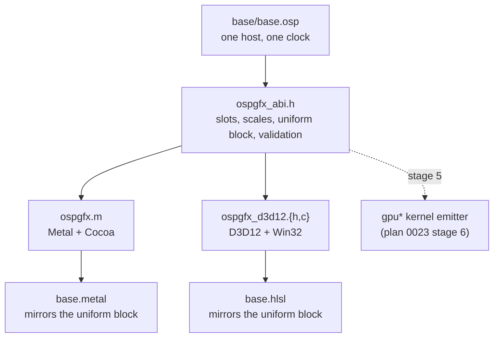

# Plan 0025 — GPU Graphics Backends: one shader library, many device APIs

**Subsystem:** `examples/graphics/` (shader libraries, the shared ABI header, platform bridges) + `Makefile` (per-OS build recipes) + `crates/osprey-cli/tests/graphics_scenes.rs` with `graphics_scenes/{abi,frame}.rs` (the drift guard)
**Status:** **macOS/Metal observed working (July 2026). Windows/D3D12 is written but has never been compiled, linked or run on Windows**; its per-frame path *is* compiled and executed on every CI platform against stubbed SDK calls and the real ABI header. Vulkan/SPIR-V is unstarted. The convergence with `gpu*` (stage 5) is unstarted.
**Priority (set 2026-10-12): subordinate to [plan 0023](0023-gpu-computation.md).** The graphics examples exist to demonstrate capability. Work here is admissible only when it advances `gpu*` reaching a device; stages 2–4 below are therefore not scheduled on their own and run only when stage 5 names what it needs from them, and stage 5 itself waits on plan 0023's stage 4 emitter.
**Spec:** none. `examples/graphics/README.md` is the current contract; a spec is owed if and when stage 5 lands, not before.
**Sibling plan:** [0023 — GPU computation](0023-gpu-computation.md) owns the `gpu*` language surface, kernel extraction and every device backend. This plan owns only the window/drawable/shader-library plumbing those backends will reuse.

## Summary

`examples/graphics/` is the only place in the repository where Osprey code causes a GPU to execute instructions. It does that by *not* using `gpu*`: an Osprey host program drives a window through six extern C functions, and a hand-written fragment shader does the per-pixel work. Osprey is the host language and the GPU is the rasteriser.

The arrangement's whole value is one sentence: **the Osprey sources are byte-identical on every platform.** `base/base.osp` and the three `scene.osp` entries are not ported, not `#ifdef`-ed and not conditionally compiled. A scene names a shader file and a fragment entry inside it; each backend resolves that name into its own dialect.

What makes this plan worth keeping under the new priority is one file: `ospgfx_abi.h`. The slot protocol it declares — a fixed vector of scalar uniforms the host fills and the shader reads — is exactly an extracted kernel's leading uniform parameters (`[GPU-KERNEL-EXTRACT]`). When plan 0023's emitter exists, it targets this header; nothing else here needs to be redone.

## The invariant: one ABI header, two shader libraries, one program

The Osprey-facing C contract is declared **once**, in `ospgfx_abi.h`: `OSP_GFX_SLOTS`, the two fixed-point scales, the `OspGfxUniforms` block, the window-extent and scale validation, the fragment-entry default, the slot store and the elapsed-time helper. Both bridges `#include` it and restate none of it; `graphics_scenes/abi.rs` fails if either bridge grows its own `#define OSP_GFX_SLOTS` or `typedef struct OspGfxUniforms` again.

The shader libraries cannot include it — each bridge compiles its shader from source at run time with no include path — so `base.metal` and `base.hlsl` each mirror the uniform block by hand. That is the silent-corruption hazard the drift guard exists for: a disagreement does not fail to compile, it shifts `res` and `time` under every scene on one platform. The guard pins both mirrors to the header, derives the two libraries' constant sets from their text and requires them to be equal in **both directions**, with the single legitimate HLSL-only name (`OSP_GFX_SLOT_REGISTERS`, the float4 register count its cbuffer packing needs) listed explicitly and asserted to be *exactly* the difference, so a stale whitelist entry fails too.

Two transcription hazards are load-bearing enough to have their own test and their own comment, because both compile cleanly when wrong:

1. **cbuffer packing.** A `float slot[24]` inside an HLSL constant buffer gets one 16-byte register *per element* and would read `slot[1]` out of the bridge's `slot[4]`. It is declared `float4 uniformSlotPack[OSP_GFX_SLOTS / 4]` and unpacked once by `loadUniforms()`; a `#if (OSP_GFX_SLOTS % 4) != 0 / #error` guards the divisibility, and `the_hlsl_constant_buffer_cannot_quietly_unpack_itself` guards the guard.
2. **Matrix convention.** Metal's `float2x2` takes **columns**; HLSL's takes **rows** and needs `mul`. `rotationFromTurns` is transposed accordingly. Get it wrong and every scene spins backwards at full frame rate.

Pixel-for-pixel identity across platforms is **not** claimed and must not be. The arithmetic is transcribed operation for operation, but the shader compilers fold, reassociate and schedule independently. "Indistinguishable", never "bit-equal".

## What works today

- **The Metal backend.** `ospgfx.m` — Cocoa window + `CAMetalLayer`, the six exported C functions (each bridge declares its own export prototypes; the header holds the data contract they share), `newLibraryWithSource:` at open time. Measured in July 2026 at 103 fps on a 1920×1200 drawable for the scene the `gpu*` host backend rendered at 13 fps; both numbers are historical and live, dated, in plan 0023's "What that costs, measured".
- **The Osprey host.** `base/base.osp` holds the fixed-point trigonometry, the per-scene oscillator and grade tables and the frame loop, exactly once. `kali/`, `opal/`, `character/` are one-file projects importing `graphics::SceneBase`; each names `../base` as a second source root because Default Osprey cannot import across standalone scripts ([MODULES-MODEL], [MODULES-ENTRYPOINT]).
- **Authored grade lives in Osprey, not the shader.** An offscreen A/B render at matched uniforms was byte-identical when the grade moved out of the shader; that is the bar stage 5 inherits.
- **The shared ABI header**, `ospgfx_abi.h`: platform-neutral C11, compiled on macOS (ObjC), on Windows (MinGW/MSVC, unverified) and on Linux by the frame-path test. The bridges' slot store, extent/scale validation and tick arithmetic are its inline helpers; each bridge keeps only the platform-specific wrapper (ObjC property copy-out/copy-in on macOS, a direct pointer on Windows).
- **The drift guard**: ten tests across `graphics_scenes.rs` (scene structure, Kali grade, fragment entries, bidirectional constant sets, cbuffer guard), `graphics_scenes/abi.rs` (header as canonical declaration, both mirrors, both bridges include-and-restate-nothing, one C ABI, host slot ranges) and `graphics_scenes/frame.rs` (the D3D12 frame functions compiled with clang `-Wall -Wextra -Werror` against the real header and stubbed SDK calls, every injected failure path asserted). An earlier mutation check of the pre-header structure detected 11/11 deliberate mutations; the post-header structure was re-checked on 2026-10-12 against the mutations listed under Landmines.
- **`make graphics SCENE=…` splits by `$(OS)`**, and both bridge recipes depend on `ospgfx_abi.h`.

## What is written but unverified

`base.hlsl`, `ospgfx_d3d12.h`, `ospgfx_d3d12_setup.c`, `ospgfx_d3d12.c` and the Makefile's `Windows_NT` branch have **never been compiled, linked or run on Windows**. They were written on macOS with no MSVC, no Windows SDK, no mingw-w64 and no fxc or dxc. Every one of those files says so at the top, `README.md` says so under "Verification status", and the Makefile branch says so in a comment. Do not remove those notices for tidiness; they are the only thing standing between "transcribed" and "works". What *is* verified on every platform is the per-frame control flow (`graphics_scenes/frame.rs`) and the ABI header's C.

The shape of what was written, for whoever verifies it: three files, not one (`_setup.c` is within a dozen lines of the 500-LOC cap — split before adding); uniforms as 28 root-constant DWORDs with a compile-time budget assertion; every HRESULT through `osp_gfx_ok`; the scene sources untouched and the `.metal` → `.hlsl` extension swap done by the bridge from the file name; `GetCPUDescriptorHandleForHeapStart` called once and cached (the one C binding that historically diverges between MSVC and mingw-w64 — **if the Windows build fails, suspect this line first**); no WARP fallback. The shader is compiled through `D3DCompile` at Shader Model 5.0 — the legacy fxc path; Microsoft's current compiler is DXC (LLVM-based, required for Shader Model 6), and SM 5.0 is kept only because the library needs nothing from SM 6.

The five commands that would settle it on Windows (fxc every entry, build the DLL warnings-fatal, type-check and link the unchanged scenes, run the drift guard, open a window for twenty seconds) are the how-to in [`examples/graphics/README.md`](../../examples/graphics/README.md) — not repeated here. Steps 1–4 need no display; step 5 needs a desktop session and a D3D12 adapter.

## Stages

Each stage keeps `make ci` green and must not change a single byte of `base/base.osp` or any `scene.osp`. That constraint is the deliverable.

### Stage 1 — Metal backend and the shared-library invariant ✅

Landed. Acceptance: `make graphics SCENE=kali|opal|character` opens a window and renders; the drift guard passes; the derived-constant and uniform-layout tests fail when either library drifts.

### Stage 2 — verify the D3D12 backend — DEFERRED

Not scheduled. Admissible only if stage 5 picks HLSL as its first emitted dialect, which it will not: the emitter must target the dialect whose hand-written library is *verified*, and that is Metal. Gate when it does run: the README's step 5 renders `kali` for twenty seconds with a non-zero frame rate, and steps 1–4 run in CI on a Windows runner. Expect fixes in the two hazards above and in HLSL spellings chosen blind (`(float3)0.0` splats, `(float)i` casts).

### Stage 3 — write the spec — DEFERRED to stage 5

`[GFX-ABI]`, `[GFX-SHADER-LIB]`, `[GFX-UNIFORMS]`, `[GFX-HOST-PORTABLE]` are owed when stage 5 lands, because that is when the contract stops being an example's and becomes the compiler's. Gate unchanged: every ID has implementing code that references it and a test that fails when it is violated.

### Stage 4 — Vulkan/SPIR-V third backend — DECISION CLOSED

The open question was the source language for a third dialect. Under the current priority it is closed: **no hand-transcribed shader will be written again.** A third dialect is admissible only as Osprey-emitted output — stage 5 here, plan 0023's stage 6 — where the LLVM SPIR-V backend (an official LLVM target since LLVM 20) and WGSL (the same device sublanguage, W3C Candidate Recommendation) are the two spellings one emitter produces. If a hand-authored multi-target shader source is ever wanted again, the authority is Slang — hosted by Khronos since 2024-11-21 and compiling one source to SPIR-V, HLSL, GLSL, WGSL and MSL — not a fourth transcription.

### Stage 5 — convergence: `gpu*` emits the shader

The end state, and the reason this is a plan rather than an examples folder. Today a scene hand-writes MSL and Osprey merely pushes uniforms. The convergence point is that plan 0023 stage 3's extracted kernels — first-order, scalar-signatured, capture-free, purity-proven — are *emitted* as MSL (Metal Shading Language, specification 4.1 as of 2026-06-04), and `base.metal` becomes generated output rather than authored source.

What each side must bring:

- From plan 0023: a device IR emitter over the extracted-kernel ABI, and a decision about kernels that decline extraction (a closure cell has no device representation — reject by name, never silently run on the host).
- From this plan: `ospgfx_abi.h`'s slot protocol is already a kernel's uniform parameter list. What is missing is a per-pixel index space (`gpuMap` is rank-1 over a flat buffer; a fragment shader is rank-2 over a drawable), and a way to express "this buffer is the drawable" without a copy — both of which plan 0023's `llm.c` reference application will also demand, which is why they are owned there.
- Shared: the emitter targets MSL first, because that is the verified library the generated output can be diffed against.

Gate: one scene's fragment body written as an Osprey kernel, compiled to the platform shader, rendering a frame byte-identical to the hand-written shader's at matched uniforms — the same A/B bar the grade refactor cleared.

## Authorities (verified 2026-10-12)

- Apple, *Metal Shading Language Specification* 4.1 (2026-06-04) — the dialect stage 5 emits first.
- Microsoft, *DirectX Shader Compiler* (DXC): the current HLSL compiler, LLVM/Clang-based, required for Shader Model 6; fxc remains only for SM 5.x. The D3D12 bridge's `D3DCompile` at `vs_5_0`/`ps_5_0` is the legacy path by choice.
- Khronos, *Slang Initiative* (launched 2024-11-21): one shading language compiled to SPIR-V, HLSL, GLSL, WGSL and MSL under open governance — the fallback for any hand-authored multi-target shader.
- Khronos, *Vulkan 1.4* (released 2024-12-03) requires SPIR-V 1.0–1.6; *SPIR-V 1.6* revision 4 (2024-07-03).
- W3C GPU for the Web Working Group, *WebGPU* and *WGSL* — Candidate Recommendation, drafts through 2026.
- LLVM, SPIR-V backend promoted to an official target (`LLVM_ALL_TARGETS`, LLVM 20) — one textual-IR emitter can feed both PTX and SPIR-V.

## Landmines

- **`examples/graphics/` is not in the differential corpus and not in CI.** It needs a display. A change here is verified by running it, or it is not verified. `make -n graphics` only proves the recipe expands. The one exception is the frame-path test, which executes the D3D12 frame functions on every platform against stubs.
- **`ospgfx_abi.h` helpers are `static inline`.** clang suppresses `-Wunused-function` for them only when the header is *included*; pasting its text into a main file (as the frame test once did) fails `-Werror`. Include it with `-I`, never inline it.
- **`_setup.c` is within a dozen lines of the 500-LOC cap.** Split before adding, not after.
- **`GFX_WARN=-Wall` drops `-Werror`** deliberately, because unverified code plus fatal warnings is a bad first-run experience. Put `-Werror` back the day stage 2 passes.
- **Windows `make graphics` requires the MSYS2 UCRT64 shell.** Native PowerShell gets a one-line pointer to the README instead of a broken recipe.
- **A shader error is otherwise invisible** — the bridge compiles the library at run time, so a typo surfaces as a window that refuses to open. `make _graphics-shader` turns that into a build failure and *skips quietly* when the toolchain is absent. A silent skip is not a pass.
- **Mutations the post-header drift guard must keep catching** (re-run after touching it): `OSP_GFX_SLOTS` changed in the header alone; `#define OSP_GFX_SLOTS` reintroduced in a bridge; a screaming-snake constant added to one shader library only; `OSP_GFX_API` dropped from one D3D12 export; `float res[2];` dropped from the header.

## TODO checklist

### Stage 1 — Metal + the invariant

- [x] `ospgfx.m`: Cocoa window, `CAMetalLayer`, the six-symbol flat C ABI.
- [x] `base.metal`: one library, one `Uniforms`, one `osp_vertex`, three named fragment entries selected by name at open time.
- [x] `base/base.osp` as the single host; three one-file scene projects.
- [x] Authored grade moved from the shader into Osprey, A/B render byte-identical at matched uniforms.
- [x] Drift guard, mutation-checked.
- [x] `make graphics SCENE=…` with an up-front `xcrun metal` shader check.
- [x] **One ABI declaration** (`ospgfx_abi.h`) included by both bridges; bridges restate nothing; the frame-path test compiles the real header; both Makefile recipes depend on it.
- [x] **Drift guard structural and bidirectional (branch review P2.9):** constant sets compared both ways with an explicit, exact HLSL-only whitelist; uniform-layout checks derived from the header; ABI checks split into `graphics_scenes/abi.rs`.

### Stage 2 — D3D12 verification (deferred)

- [x] `base.hlsl` transcribed entry for entry, with the `float4` cbuffer packing, its `#error` divisibility guard, and the transposed `rotationFromTurns`.
- [x] Three-file bridge, six exports, identical semantics and encodings, root-constant uniforms with a compile-time budget assertion, every HRESULT through `osp_gfx_ok`.
- [x] Makefile `Windows_NT` branch + fxc entry-point check + PowerShell pointer.
- [x] Frame-path failures propagate (branch review P1.13), pinned by `direct3d_frame_failures_are_reported_and_resources_retained`, which compiles the actual frame functions against the real ABI header with injected SDK failures. This verifies control flow, not Windows SDK compatibility or rendering.
- [ ] Execute the README's five Windows steps; replace the "unverified" notices with observed results; restore `-Werror`; decide on a WARP fallback. **Deferred: not admissible under the current priority unless stage 5 needs HLSL.**
- [x] `vscode-extension/test/suite/extension.test.ts` no longer describes `examples/graphics/scene.metal` as a present file (comment fix).

### Stage 3 — spec (deferred to stage 5)

- [ ] `[GFX-ABI]`, `[GFX-SHADER-LIB]`, `[GFX-UNIFORMS]`, `[GFX-HOST-PORTABLE]` in a new `docs/specs/` entry, each referenced from the implementing code — when stage 5 lands.

### Stage 4 — Vulkan/SPIR-V (decision closed)

- [x] Source-language decision recorded: no hand transcription; Osprey-emitted only (stage 5); Slang is the authority if hand-authored multi-target source is ever wanted.
- [ ] Any SPIR-V/WGSL output arrives through plan 0023's stage 6 emitter, not through a fourth hand-written library.

### Stage 5 — convergence with `gpu*`

- [ ] Device shader emitter over plan 0023's extracted-kernel ABI, targeting MSL first and `ospgfx_abi.h`'s slot protocol as the uniform binding.
- [ ] Rank-2 index space for per-pixel kernels; a drawable expressible as a buffer without a copy (owned by plan 0023's surface work).
- [ ] One scene's fragment body written as an Osprey kernel, rendering a frame byte-identical to the hand-written shader at matched uniforms.
- [ ] `base.metal` becomes generated output; the hand-written library is kept as the differential reference, not deleted.

### Cross-cutting

- [ ] Any new backend keeps `base/base.osp` and every `scene.osp` byte-identical — the invariant, and the first thing to check in review.
- [ ] `docs/messaging.md` says GPU *computation* is host-only. This plan is the exception that proves it: Osprey hosting a GPU shader is real and may be described; `gpu*` reaching a GPU is not, and must not be conflated.
