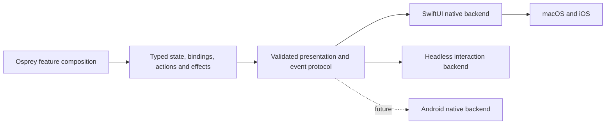

# Native Osprey application framework [UI-FRAMEWORK]

**Status: proposed library/framework design.** Native macOS and iOS are mandatory. Follow the storage app: Osprey builds application state and declarative presentation; SwiftUI is the first native backend and Swift services execute platform work. The public Osprey model is independent of SwiftUI's types and lifecycle. AppKit/UIKit integration supplies platform features where the backend needs it. No Flutter, browser shell, Dart or JavaScript runtime is part of this architecture.

## Starting point and framework boundary [UI-FOUNDATION]

The existing [storage entry](https://github.com/Nimblesite/osprey/blob/main/examples/macos/storage/src/main.ospml), [browser](https://github.com/Nimblesite/osprey/blob/main/examples/macos/storage/src/browse.ospml), [view](https://github.com/Nimblesite/osprey/blob/main/examples/macos/storage/src/view.ospml), [Swift store](https://github.com/Nimblesite/osprey/blob/main/examples/macos/OspreyStorage/StorageStore.swift) and [shared native renderer](https://github.com/Nimblesite/osprey/blob/main/examples/mobile/ios/IssueInbox/NativeRenderer.swift) already establish the pattern. They contain useful app-specific composition and host services; the renderer alone is not a complete framework.

Build an Osprey-first native application framework with a public, typed component API and a SwiftUI host package. The framework owns application lifecycle, state subscriptions, composition, identity, routing, bindings, commands, forms, data presentation, styling, accessibility, persistence hooks and diagnostics. The renderer is an internal backend consuming a validated description. App authors compose reusable functions and modules instead of maintaining a list of string-keyed widget conversions or serializing JSON by hand.

The central design is to describe an interaction once in Osprey: what data it edits, which actions it permits, how selection and navigation relate, and what service work it requests. A backend chooses its native presentation while preserving those semantics. An editable field is a typed binding with validation, focus, commit and cancellation behavior; a collection is identity, selection, queries and actions with a native presentation. Neither is merely the name of a widget.

## Backend-independent authoring contract [UI-TYPED-API]

The conceptual public types are `App<Model, Action>`, `Component<Props, Action>`, `View<Action>`, `Binding<Value, Action>`, `Form<Draft, Action>`, `Selection<Key>`, `Route` and `Command<Action>`. These are proposed API contracts, not verified Osprey declarations. Implement them with existing records, unions, generic functions, modules and effects; prove representability before publishing exact syntax. A small set of orthogonal primitives must compose into richer components without new host branches for each feature.

| Authoring guarantee | Required proof |
| --- | --- |
| Actions are scoped unions | A component cannot emit an unrelated feature action; child actions are explicitly lifted into their parent. A missing update case fails type checking. |
| Bindings preserve value types | A text editor cannot bind a boolean, and a number field cannot emit arbitrary strings as valid domain values. Parsers preserve invalid drafts until corrected or cancelled. |
| Routes and IDs have meaning | An app detail requires an app identity; a finding identity cannot silently substitute. Navigation and restoration validate the typed route. |
| Styling has a contract | Semantic roles and typed tokens replace arbitrary style strings; unsupported backend-specific presentation is an explicit capability, with a documented alternative or refusal. |
| Forms compose validation | Field errors, cross-field rules and asynchronous validation attach to typed fields and a draft revision; stale checks cannot authorize submit. |
| Effects separate services | The same feature runs with native, fixture and recording handlers; service choice does not alter its component code. |
| Framework owns mechanical work | Authors do not write JSON, callback registries, focus reconciliation, cancellation plumbing or platform-specific state wrappers for each feature. |

The serialization boundary erases types only after these checks. Event bindings carry framework-issued opaque IDs and a declared payload schema; the host returns the ID and bounded value, and Osprey decodes it into the original action. It cannot construct arbitrary privileged actions from an event dictionary. Reject events for disposed components, wrong revisions, unknown IDs and mismatched payloads. UI binding IDs are not authorization tokens; security actions still require independent policy checks.

No public API imports SwiftUI names such as `AnyView`, `ObservableObject`, `@State`, `Binding` or `NavigationPath`; the generic `Binding<Value, Action>` above is the Osprey concept. Components express semantic layout and behavior without copying SwiftUI's modifier syntax or view ownership rules. Native-only extensions are explicit adapter capabilities, not mandatory dependencies of every screen.

The headless backend must execute interaction semantics, not just print a tree. It drives focus, edits, selection, navigation and commands against the same feature model. It provides the first concrete proof that SwiftUI is an adapter rather than the public framework model.

## Effects as the application architecture [UI-EFFECTS]

Application components request capabilities such as evidence queries, persistence, clock, notifications and approved collection through typed effects. Native handlers interpret them against platform services; fixture handlers provide deterministic data and recording handlers assert requests. The UI does not receive a bag of service objects or acquire ambient filesystem/network authority. A native backend can change without rewriting the feature's service requests.

Separate pure composition from effectful workflows: rendering a component never starts a scan merely because SwiftUI reevaluated its body. An explicit typed action or mounted subscription requests work; the framework owns its scope, cancellation and completion. Effect handlers define interpretation, while runtime authorization independently checks whether a request is permitted. Static discharge is not an operating-system security sandbox.

Use callable value-effect handlers and explicit completion events already supported by the mobile boundary. Do not assume freely escaping continuations, independently quantified effect rows in function types, or dynamic control effects across C. A proposed effect API must pass both type checks and real Mac/iOS embedding tests before it becomes the public contract. This makes effects a usable foundation without promising unsupported compiler behavior.

Reuse [the reactive application contract](https://github.com/Nimblesite/osprey/blob/main/docs/specs/applications/0040-ReactiveMobileApplications.md) and [Apple C ABI](https://github.com/Nimblesite/osprey/blob/main/docs/specs/platforms/0038-iOSTarget.md). Add reusable contracts in libraries, not speculative syntax, a new rendering engine or compiler features. Compiler stabilization remains a prerequisite; a framework requirement that current Osprey cannot safely implement is a tracked blocker with a failing compiler test, not a hidden workaround.

## Package responsibilities [UI-PACKAGES]

Names below are logical package boundaries, not claims that these packages exist or that an Osprey package manager is shipped.

| Package | Language and responsibility |
| --- | --- |
| `native-app/core` | Osprey: application/reducer lifecycle, immutable model, typed actions, command/effect descriptions, subscriptions and cancellation generations |
| `native-app/ui` | Osprey: backend-independent typed components, slots, keys, route definitions, form/binding descriptors, design tokens, localization messages and accessibility semantics |
| `native-app/protocol` | One versioned boundary schema plus Osprey codecs and Swift decoded types; strict validation and compatibility fixtures |
| `OspreyNative` | Swift package: reusable SwiftUI host, native composition, state/binding reconciliation, scenes, platform control adapters, protocol errors and accessibility integration |
| `native-app/testing` | Osprey deterministic handlers, transition traces, semantic view assertions, fixture app and protocol round trips |
| `security/domain` and `security/features` | Osprey: evidence/rules/policy and security screens/workflows, composed from framework components |
| `SecurityPlatform` | Swift/C where required: permission APIs, signing, filesystem, collectors, Keychain, IPC and system-extension lifecycle; no duplicated detection rules |

Swift owns layout implementation details required by native controls, focus/IME state, OS lifecycle and OS services. Osprey owns what the screen represents, component composition, labels, application navigation, validation policy, sorting/filtering and enabled actions. Native semantics can adapt to the platform without recoding the domain in Swift.

## Authoring and composition [UI-COMPOSITION]

Components are pure Osprey functions of explicit props and scoped state producing typed UI descriptions and action bindings. Components compose through named content/action slots; callers can supply reusable children and behaviors through the existing language's functions/modules. Public component APIs cover screen, split view, section, stack, list/table, inspector, form, field, toolbar, menu, sheet, alert and status, then smaller native controls. Invalid combinations should fail type checking where representable; boundary-only constraints receive explicit validation errors.

Every stateful/reorderable component has a stable semantic key, unique within its parent. Key identity survives sorting and refresh; identity is never the row index or visible label. Reconciliation preserves editing, selection, expanded groups, scroll anchors and focus for surviving keys, and disposes subscriptions when their scope disappears. A scan update must not rebuild the entire app or reset a text cursor.

Slots include loading, empty, denied, error and stale-content presentation. Components support reusable modifiers for spacing, emphasis, accessibility, conditional visibility and command availability, with documented composition order. Resolve tokens through the theme; do not scatter platform colors or hardcoded geometry across app modules. The wire format remains an implementation boundary, not the application-authoring API.

## State, effects and lifecycle [UI-LIFECYCLE]

One serialized dispatcher applies `model + action -> next model + commands`. Derived selectors expose only the state a component consumes. Commands are typed descriptions interpreted by handlers; asynchronous completions include request ID, feature scope and generation. Each feature declares subscriptions and teardown; cancellation and stale completion rejection are framework behavior. User cancellation is a visible completed state, not a generic error.

The native host initializes the Osprey library once, copies boundary output immediately and never calls it concurrently. Work queues perform native I/O away from the UI thread; completions enter the serialized dispatcher. High-volume evidence remains in a bounded native store and is paged by Osprey requests; it is not copied into a full serialized model every frame. Coalesce high-rate events without losing security event counts or hiding dropped data.

Scenes have explicit create, activate, background, resume and destroy events. macOS windows share the evidence store but maintain independent route/selection/focus state. Background monitoring belongs to an approved service with an explicit user setting; closing a window and quitting the application have documented behavior. iOS suspension never promises a continuously running scanner.

## Routing and presentation [UI-NAVIGATION]

Routes are typed application values: overview, inventory, app detail, activity, permissions, files, network, finding detail, investigation and settings. Route state supports navigation/back, selected item, sheet/alert presentation and deep links through a validated allowlist. Do not let arbitrary evidence URLs create routes or execute commands. Navigation restoration validates asset existence and current permissions.

Use native Mac sidebar/content/inspector composition, native tables and keyboard commands; use iPhone stack navigation and iPad split layouts. A narrow window can collapse the inspector without dropping selection. Route-to-platform presentation is a host responsibility; application routes and permission rules are shared. Framework APIs expose sheet dismissal, unsaved-change protection, command validation and accessibility focus restoration.

## Data, bindings and forms [UI-INTERACTION]

| Contract | Required behavior |
| --- | --- |
| Lists/tables | Native virtualization, stable row identity, selection/multiselection, sorting, filters, pagination, context menus, keyboard traversal and explicit loading/error rows |
| Bindings | Typed value/action pair with edit policy: immediate, debounced or commit. Preserve composition text and selection; external updates cannot overwrite an in-progress edit without reconciliation. |
| Forms | Reusable field groups, local draft state, dirty/touched state, synchronous validation, correlated asynchronous validation, inline errors, submit/cancel, disabled reasons and focus-first-error behavior |
| Commands | Shared enabled/reason/shortcut state for toolbar, menu and keyboard invocation; one action implementation. Destructive roles require native confirmation where appropriate. |
| Feedback | Progress with cancellation, status announcements, retained content on refresh failure, empty/denied/partial states and actionable errors with diagnostic IDs |
| Presentation | Native sheets, popovers, alerts, menus and inspectors; predictable dismissal and restoration |

An app-specific field is a composition of these contracts, not a new special case in the host. A finding detail view composes evidence, source references, timeline and actions through ordinary components. AI chat is a feature using the same list, draft, task and command abstractions; it does not own global navigation or privileges.

## Native quality [UI-PLATFORM]

Use [SwiftUI](https://developer.apple.com/swiftui/) and its [model data](https://developer.apple.com/documentation/swiftui/model-data), [navigation](https://developer.apple.com/documentation/swiftui/navigation), [scene](https://developer.apple.com/documentation/swiftui/scenes) and [form](https://developer.apple.com/documentation/swiftui/form) facilities. Add AppKit/UIKit adapters for actual platform gaps behind the same framework API. These are the rendering/platform mechanisms; Osprey retains application ownership.

The host provides system typography, light/dark appearance, accent preferences, Dynamic Type where applicable, high contrast, reduced motion, VoiceOver semantics and meaningful focus order. Severity is labeled in text as well as color. Localized messages support pluralization and interpolation without requiring concatenated English sentence fragments. Right-to-left layout, long labels, keyboard-only use and text scaling are acceptance cases.

macOS acceptance includes menus/shortcuts, window resizing, multiple windows, native selection, context menus, copy/export and open/reveal affordances. iOS acceptance includes safe areas, software/hardware keyboard handling, rotation, background/resume, native pickers and denied-permission guidance. Android can later map the same semantic components into native Kotlin controls; it must preserve behavior and accessibility, not Apple pixels.

## Protocol and memory [UI-BOUNDARY]

Version the envelope, state revision, component/event schema and host capabilities. Unknown mandatory fields/kinds or malformed commands produce explicit diagnostics and no privileged operation. Optional feature negotiation must not reinterpret unsupported security operations as success. Bound string length, tree depth, node count, event size and action rate before decoding or dispatching.

The existing opaque model plus UI/commands envelope is the compatibility starting point. Introduce typed codecs and internal schema checks first; preserve old consumers during extraction and remove duplicate implementations once migrated. Any code generation is for codecs/bindings from one checked-in schema, with reproducible output and drift checks; it is not a new language frontend.

The Apple embedding contract currently uses a retaining default allocator and lacks a stable returned-string release API. Returning a fresh full model/UI string indefinitely is unacceptable for a monitoring app. Copying output does not release Osprey allocations. Prove bounded lifetime with a supported runtime ownership solution before continuous operation; simply restarting every few minutes or freeing foreign pointers is not an accepted fix. Keep this a compiler/runtime hardening dependency with tests, not an undocumented framework assumption.

## Acceptance contract [UI-VERIFICATION]

The framework is accepted only when all of the following are demonstrated:

1. A storage-browser feature and security-inventory feature use the same public Osprey component/state APIs and the same native host package, with no app-name branches in the renderer. A framework change benefits both consumers.
2. Compose a reusable search/filter/table/detail feature without host edits; prove stable selection, sorting, context menu actions, keyboard shortcuts and independent window state.
3. A form proves IME editing, focus preservation during incoming scan updates, validation, cancel, submit and stale asynchronous-result rejection. Editing state must not jump between reordered rows.
4. Mac and iOS render equivalent semantic state with native idioms; snapshots plus interaction and accessibility tests prove behavior. Compile success alone does not meet this bar.
5. Bounded-memory soak, cancellation/restart, event backpressure, malformed protocol and unrecognized command tests pass. Record heap growth and latency against fixed datasets before setting release budgets.
6. Add a third composed feature using documented extension points without adding app-specific widget branches. API documentation, a component catalog, preview fixtures and debugging tools ship with the framework.
7. Negative compilation fixtures reject wrong binding values, unrelated actions, invalid route identities and incomplete action handling. The same source feature passes headless and native interaction tests without SwiftUI concepts in its public API.
8. An API usability exercise implements a searchable editable collection, validated detail form and asynchronous task using only public composition APIs. Record handwritten Osprey/Swift lines and repeated plumbing; remove repetition in the framework before calling the API ergonomic. Framework internals may be substantial; application authoring must remain concise.

Android acceptance is a subsequent milestone using the existing Android C ABI/JNI path and a native Kotlin host. Apple delivery does not wait for Android.
